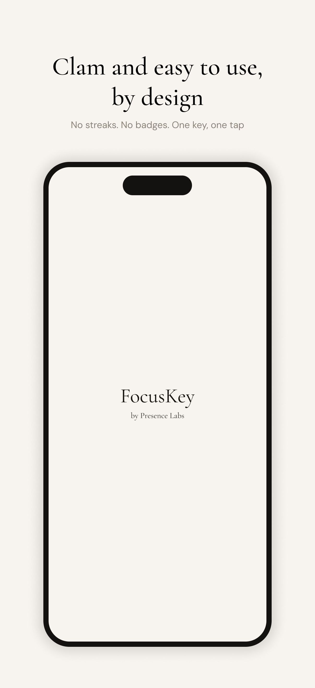
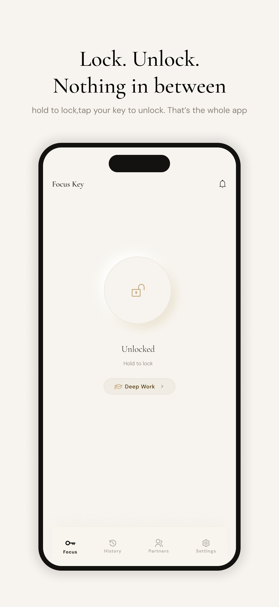
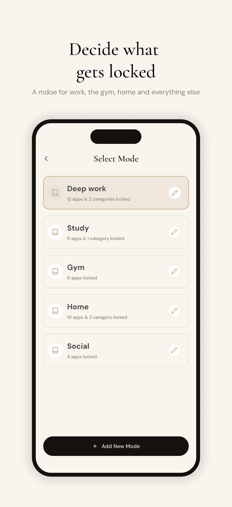
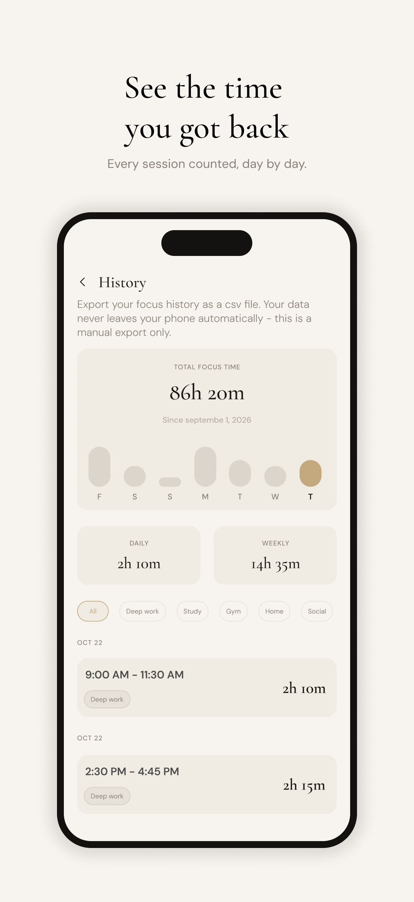

𝐅𝐨𝐜𝐮𝐬 𝐊𝐞𝐲 - 𝐒𝐭𝐚𝐲 𝐅𝐨𝐜𝐮𝐬𝐞𝐝

A mobile application designed to help users stay focused by managing app access and focus sessions across iOS and Android.

𝗢𝘃𝗲𝗿𝘃𝗶𝗲𝘄

Focus Key combines Flutter-based mobile development with native platform integrations to support focus management features and device-level functionality.

𝗦𝗰𝗿𝗲𝗲𝗻𝘀𝗵𝗼𝘁𝘀

  
  
  
  
  

𝗞𝗲𝘆 𝗙𝗲𝗮𝘁𝘂𝗿𝗲𝘀

- App restriction and focus session workflows
- NFC-based unlocking functionality
- iOS Screen Time integration using FamilyControls and ManagedSettings
- Push notifications
- Cross-platform development with Flutter

𝗧𝗲𝗰𝗵 𝗦𝘁𝗮𝗰𝗸

- **Framework:** Flutter
- **Language:** Dart
- **Platform Integration:** Native iOS and Android
- **iOS APIs:** FamilyControls, ManagedSettings
- **Backend Services:** Firebase
- **Device Interaction:** NFC

𝗣𝗹𝗮𝘁𝗳𝗼𝗿𝗺 𝗦𝘂𝗽𝗽𝗼𝗿𝘁

- iOS
- Android

Some features depend on platform-specific APIs, operating system permissions, and device capabilities.

𝗔𝗽𝗽 𝗦𝘁𝗼𝗿𝗲

View Focus Key on the App Store- https://apps.apple.com/app/focus-key-stay-focused/id6775448452

𝗗𝗲𝘃𝗲𝗹𝗼𝗽𝗲𝗿

Developed with Flutter and native platform integrations to deliver a focused mobile experience.

GitHub Profile- https://github.com/erfanworks | Portfolio- https://shawon-flutter.vercel.app
